# Diagramas UML — Cuidado Asilo

Los diagramas están escritos en **Mermaid**, que GitHub, GitLab, VS Code (con la extensión *Markdown Preview Mermaid Support*) y Obsidian dibujan automáticamente. También se pueden pegar en <https://mermaid.live> para exportarlos como imagen.

Índice:
1. [Casos de uso](#1-diagrama-de-casos-de-uso)
2. [Clases (modelo de dominio)](#2-diagrama-de-clases-modelo-de-dominio)
3. [Clases (módulos de la aplicación)](#3-diagrama-de-clases-módulos-de-la-aplicación)
4. [Componentes](#4-diagrama-de-componentes)
5. [Secuencia: arranque de la app](#5-secuencia-arranque-de-la-app)
6. [Secuencia: registrar una toma](#6-secuencia-registrar-una-toma)
7. [Secuencia: configurar y recibir recordatorios](#7-secuencia-configurar-y-recibir-recordatorios)
8. [Estados de una toma](#8-diagrama-de-estados-de-una-toma)
9. [Actividad: ronda de medicación](#9-diagrama-de-actividad-ronda-de-medicación)
10. [Actividad: alta de medicamento](#10-diagrama-de-actividad-alta-de-medicamento)
11. [Navegación](#11-diagrama-de-navegación)
12. [Despliegue](#12-diagrama-de-despliegue)

---

## 1. Diagrama de casos de uso

Mermaid no tiene un tipo nativo de casos de uso; se representa con actores (rectángulos) y casos de uso (óvalos) dentro del límite del sistema.

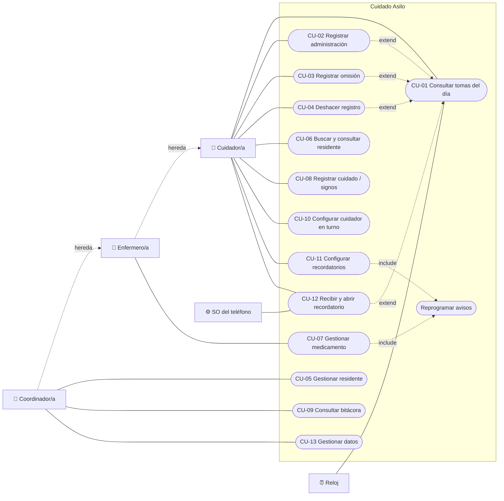

---

## 2. Diagrama de clases (modelo de dominio)

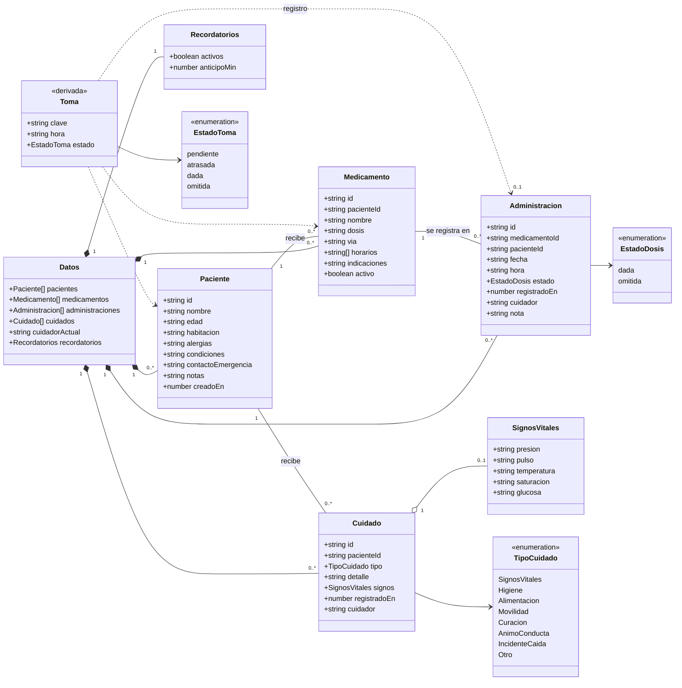

---

## 3. Diagrama de clases (módulos de la aplicación)

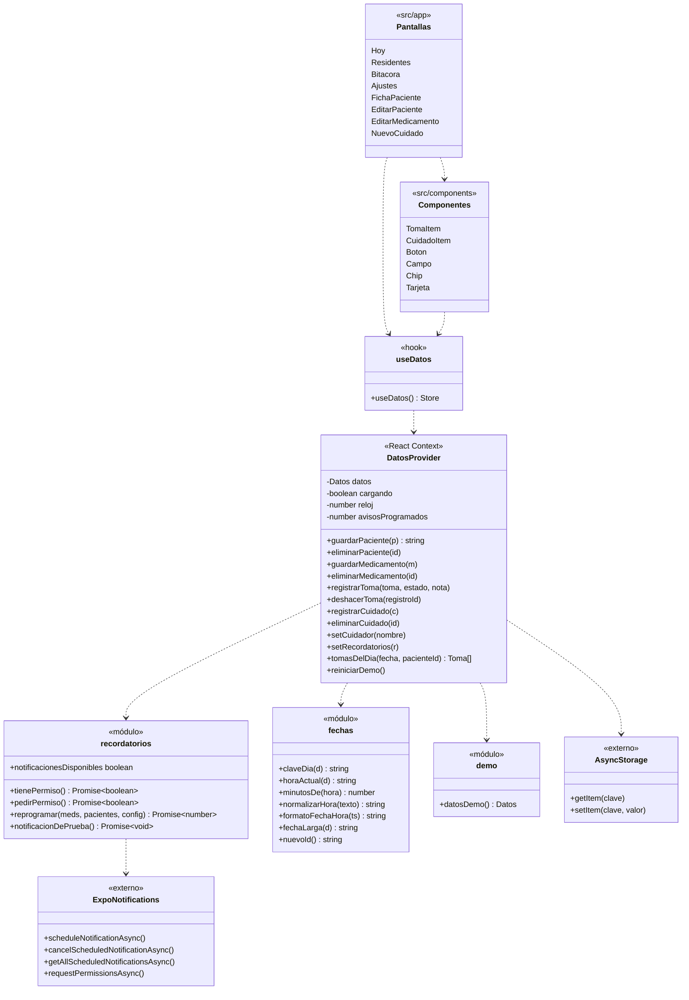

---

## 4. Diagrama de componentes

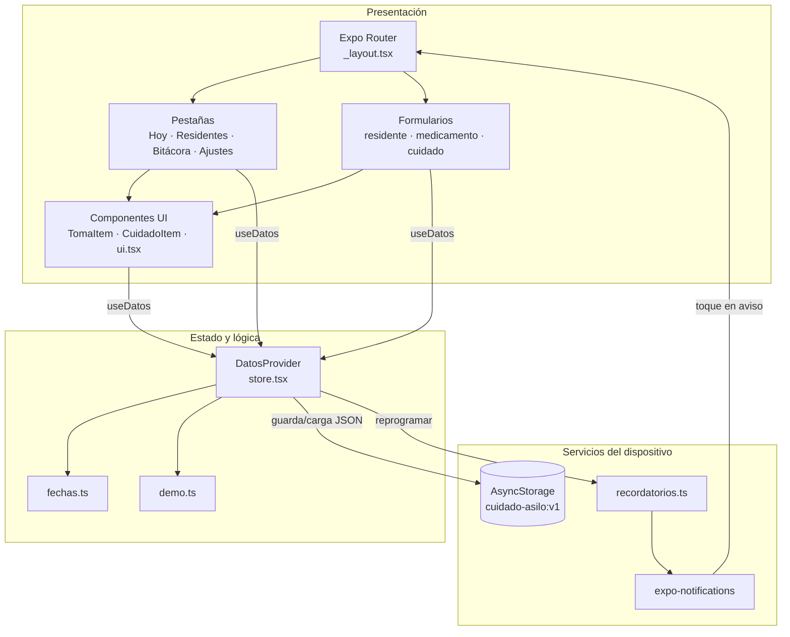

---

## 5. Secuencia: arranque de la app

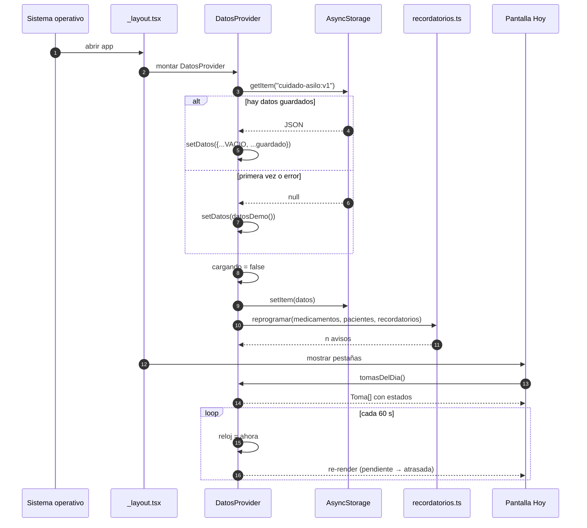

---

## 6. Secuencia: registrar una toma

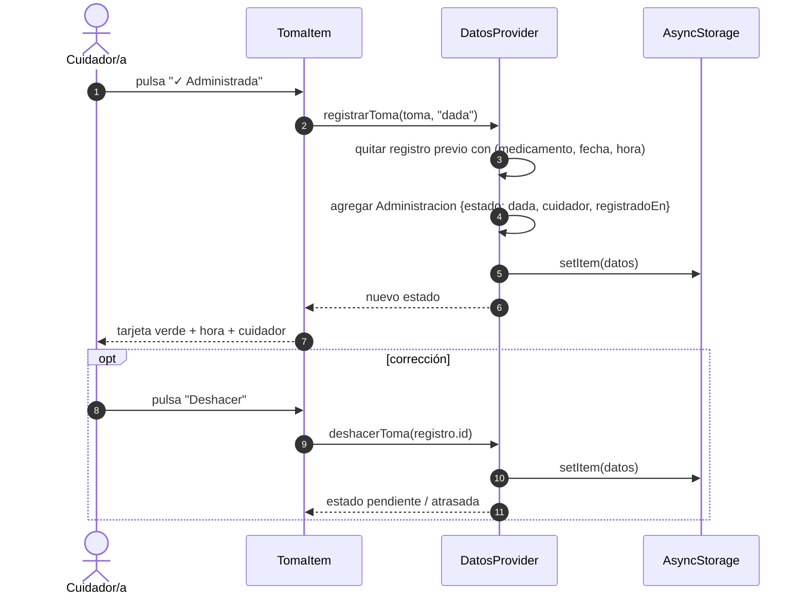

---

## 7. Secuencia: configurar y recibir recordatorios

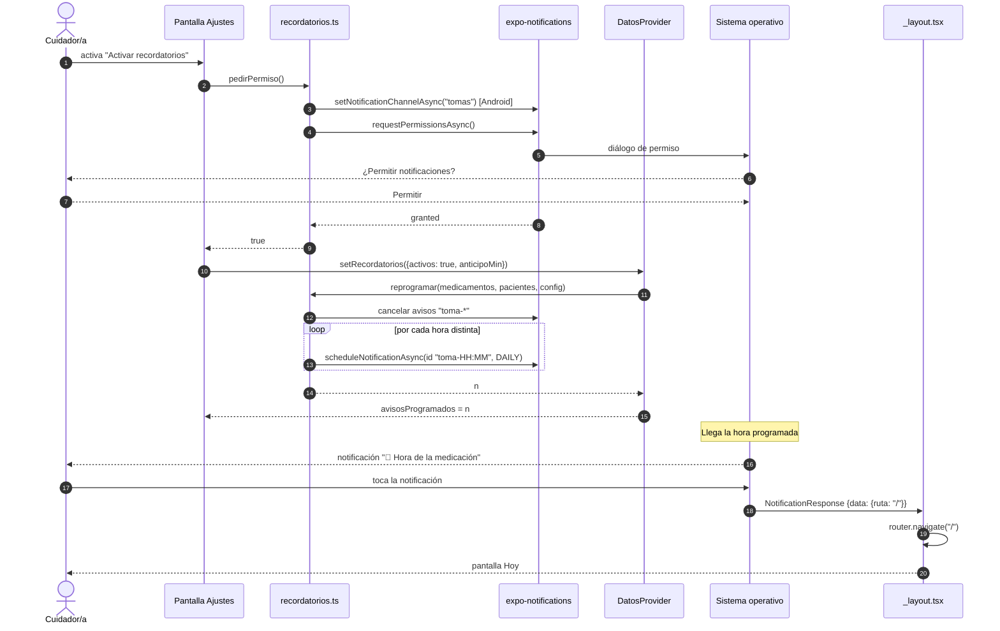

---

## 8. Diagrama de estados de una toma

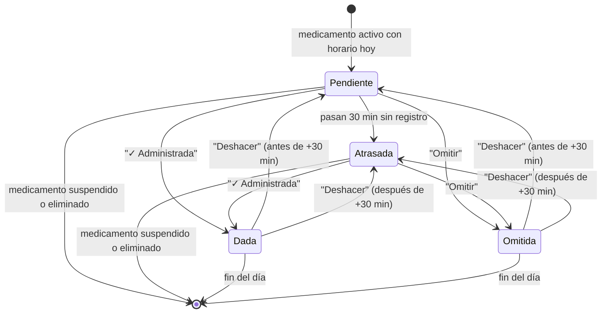

---

## 9. Diagrama de actividad: ronda de medicación

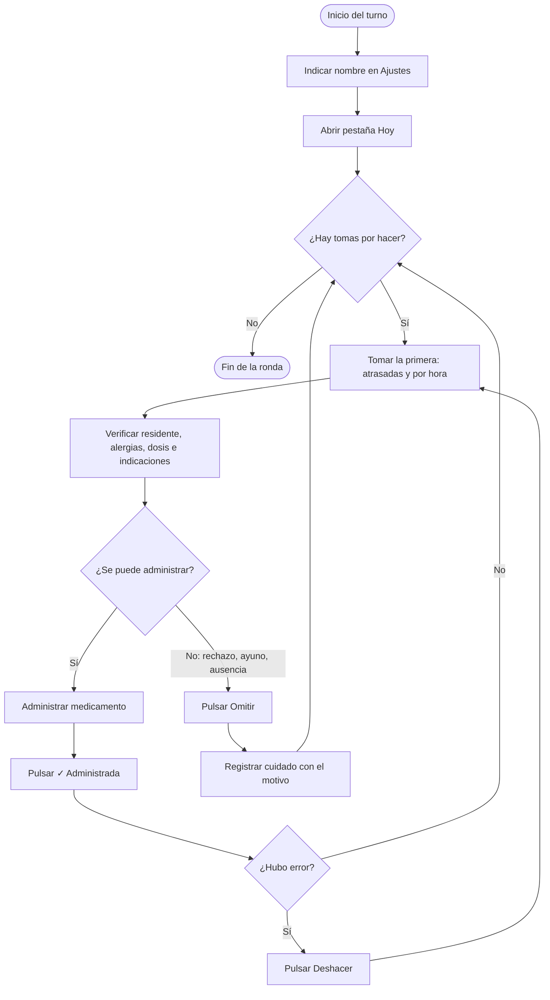

---

## 10. Diagrama de actividad: alta de medicamento

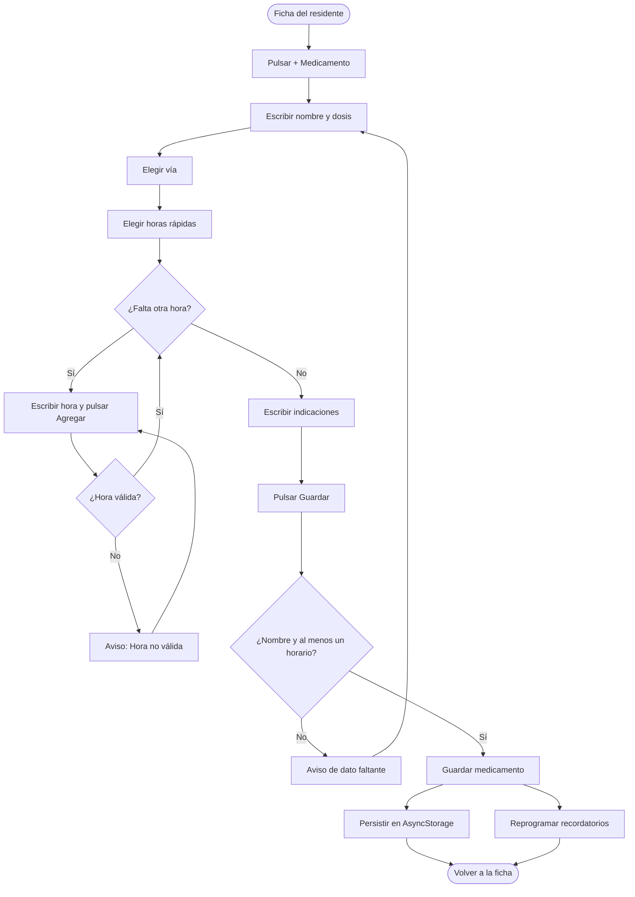

---

## 11. Diagrama de navegación

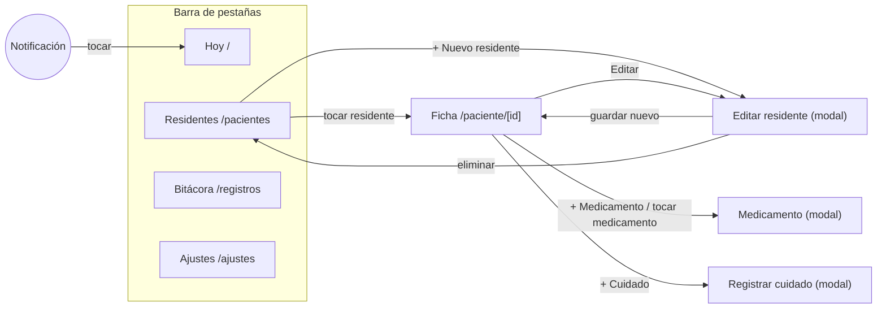

---

## 12. Diagrama de despliegue

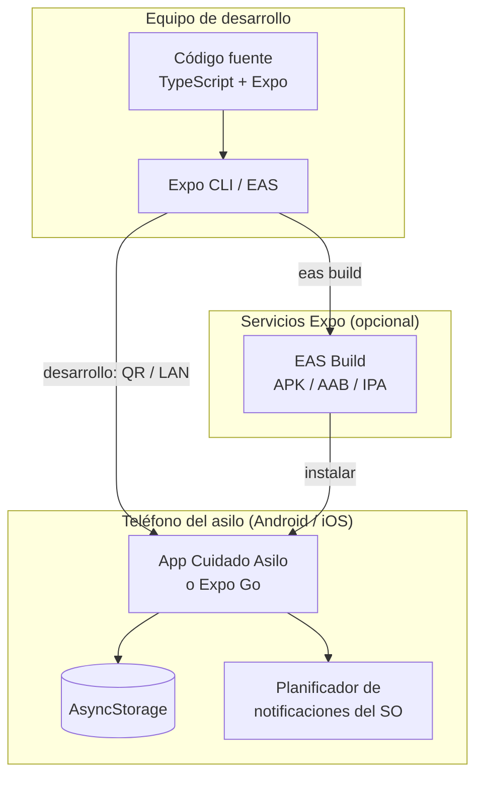
